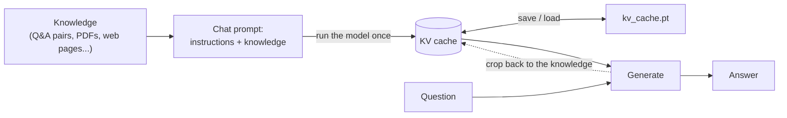

# mantiq

**Cache-Augmented Generation (CAG) for HuggingFace models.** mantiq reads your knowledge into the model's KV cache once, then answers any number of questions from it, with no retrieval pipeline and without re-reading the knowledge for every question.

[](https://github.com/Ahmed-Ousama/mantiq/actions/workflows/tests.yml)

[](https://github.com/Ahmed-Ousama/mantiq/blob/main/LICENSE)
[](https://github.com/Ahmed-Ousama/mantiq/releases/download/v0.2.0/mantiq-paper.pdf)
[](https://colab.research.google.com/github/Ahmed-Ousama/mantiq/blob/main/examples/mantiq-demo.ipynb)

<picture>
  <source media="(prefers-color-scheme: dark)" srcset="https://raw.githubusercontent.com/Ahmed-Ousama/mantiq/main/images/mantiq-dark.svg">
  
</picture>

```python
from mantiq import NaiveCAG

cag = NaiveCAG("Qwen/Qwen3-0.6B", chat_template_kwargs={"enable_thinking": False})

# Read the knowledge once...
kv_cache, _ = cag.prepare_kvcache_from_loader(open("faq.txt").read())

# ...then answer any number of questions from it.
for chunk in cag.stream_response("Do you deliver on weekends?", kv_cache):
    print(chunk, end="", flush=True)
```

## Why CAG

RAG retrieves a few chunks for every question. That means embeddings, a vector store and a chunking strategy, and an answer can only be as good as the chunks that were retrieved. When your knowledge fits in the model's context window (a product catalog, an FAQ, a policy, a manual), you can skip all of that:

- **Fast answers.** The model reads the knowledge once. Each question then only processes its own few tokens.
- **No retrieval misses.** Every answer sees all of the knowledge, not just the top-k chunks.
- **Read once, reuse anywhere.** Save the cache to disk and load it in another process or after a restart.
- **Knows its sources and stays current.** `cite()` points to the documents an answer comes from (its top citation is a supporting paragraph 93% of the time on HotpotQA with Qwen3-4B), and `update_kvcache()` re-reads only what changed.

Answering 5 questions about a 2,355-token product catalog:

| | first token | full answer |
| --- | ---: | ---: |
| Re-reading the knowledge for every question | 34.33 s | 37.21 s |
| mantiq (knowledge cached once) | **0.53 s** | **3.39 s** |
| Speedup | **65x** | **11x** |

<sub>Qwen3-0.6B in bfloat16 on a laptop CPU (Intel i7-9850H), answers of up to 32 tokens, averaged over 5 questions. Caching the knowledge took 33 s, once. The more knowledge, the bigger the gap. Measure your own setup with <code>python examples/benchmark.py</code>.</sub>

## How it works



mantiq renders the model's own chat template with a placeholder where the question goes, runs the model over everything before it and keeps the resulting KV cache. For each question it feeds only the question and the end of the turn, generates the answer, then crops the cache back so the next question starts from the knowledge alone.

## Install

```bash
pip install mantiq

# with the document loaders (PDF, CSV, JSON, Markdown, HTML, web pages, ...)
pip install "mantiq[loaders]"
```

Or the latest version from GitHub: `pip install git+https://github.com/Ahmed-Ousama/mantiq.git`

mantiq runs on CPU out of the box. With a CUDA GPU, models are loaded in 4-bit automatically.

## Quickstart

```python
from mantiq import NaiveCAG

catalog = [
    {"question": "What are the features of the Vision 55 TV?", "answer": "It has 4K resolution, HDR10 and smart apps.", "context": "55-inch TV, $499, 2-year warranty."},
    {"question": "Do you deliver?", "answer": "Delivery is free for orders over $300, otherwise $25.", "context": "Delivery takes 2-4 business days."},
]

cag = NaiveCAG("Qwen/Qwen3-0.6B", chat_template_kwargs={"enable_thinking": False})

kv_cache, seconds = cag.prepare_kvcache(
    dataset=catalog,
    prompt_instruction="You are a friendly sales agent for an electronics store.",
    answer_instruction="Answer in one or two sentences, using only the given context.",
)

print(cag.generate_response("I want a 4K screen, what do you have?", kv_cache))
# The Vision 55 TV has a 4K resolution, HDR10, and smart apps.
print(cag.generate_response("How long does delivery take?", kv_cache))
# Delivery takes 2-4 business days.
```

The full script is in [`examples/quickstart.py`](https://github.com/Ahmed-Ousama/mantiq/blob/main/examples/quickstart.py). To try citations, answer checks, conversations and updates in the browser on a free GPU, open the [Colab notebook](https://colab.research.google.com/github/Ahmed-Ousama/mantiq/blob/main/examples/mantiq-demo.ipynb).

## Usage

### Knowledge from documents

```python
from mantiq.loaders import LoaderFactory

# "PDF", "CSV", "JSON", "Markdown", "HTML", "Text", "WebPage", "Directory", "MicrosoftFile" (case-insensitive)
text = LoaderFactory.get_loader("PDF", "./catalog.pdf")

kv_cache, seconds = cag.prepare_kvcache_from_loader(text, prompt_instruction="You are a support agent.")
```

`prepare_kvcache_from_loader` takes any string, so you can also pass text you already have. Extra keyword arguments go to the underlying LangChain loader, e.g. `LoaderFactory.get_loader("JSON", "data.json", jq_schema=".items[].text")`. For Azure Document Intelligence (`"MicrosoftFile"`), install `mantiq[azure]`.

### Citations: which documents an answer comes from

Pass the knowledge as separate documents, a list or a dict of names to texts, and `cite()` tells you which of them an answer draws on:

```python
kv_cache, _ = cag.prepare_kvcache_from_loader({
    "delivery.md": "Delivery takes 2-4 business days. It is free for orders over $300.",
    "returns.md": "Returns are accepted within 14 days with the receipt.",
})

answer = cag.generate_response("Can I send it back?", kv_cache)
cited = cag.cite("Can I send it back?", answer, kv_cache)

cited.citations  # [Citation(document="returns.md", text="Returns are...", score=...)]
cited.supported  # from 0 to 1: low when the answer doesn't come from the knowledge
```

`cite()` works on the cache itself, without re-reading the knowledge:

- **With citation heads**, built in for 11 models (Qwen3 0.6B to 8B, Llama 3.2 1B and 3B, Llama 3.1 8B, Gemma 3 1B and 4B, Mistral 7B v0.3, Phi-4-mini) or found for any model with `calibrate_citations()`: a few attention heads in a model look at the document an answer comes from, and `cite()` ranks the documents by where they look, in one pass however many documents there are.
- **Without them**, it hides each document from the cache in turn and ranks the documents by how much less likely the answer becomes. With more than `max_candidates` documents (16 by default), only the ones the answer attends to most are hidden.

A citation's `score` is how much less likely the answer becomes with that document hidden, in nats per token. With `prepare_kvcache`, each Q&A entry is a document, cited by its index.

To find the heads for another model, calibrate once on a cache with a few dozen documents:

```python
heads = cag.calibrate_citations(kv_cache)  # 2 to 4 minutes on a T4 GPU, once per model
cag = NaiveCAG("your/model", citation_heads=heads)  # reuse them later
```

The model writes a question about 20 of the documents, answers each one from the cache, and mantiq keeps the heads that most often look at the document whose hiding hurts the answer most. No labeled data is needed; pass your own `questions` if you have them.

How well it works, without → with citation heads. [HotpotQA](https://hotpotqa.github.io/) questions come with 10 paragraphs, 2 of them labeled as supporting the answer, so picking at random finds one 20% of the time. [SQuAD](https://rajpurkar.github.io/SQuAD-explorer/) questions come with their paragraph and 9 others.

| Model | HotpotQA: top citation supporting | HotpotQA: both in the top 2 | SQuAD: top citation right |
| --- | ---: | ---: | ---: |
| Qwen3-0.6B | 69% → **74%** | 34% → 30% | 95% → **97.5%** |
| Qwen3-1.7B | 81% → **87.5%** | 30% → **40%** | 97.5% → **100%** |
| Qwen3-4B | 87% → **93%** | 43% → **56%** | 98% → **99%** |
| Qwen3-8B (4-bit) | 89% → **92.5%** | 37.5% → **45%** | 100% → 100% |
| Mistral-7B-Instruct-v0.3 (4-bit) | 86% → **91%** | 40% → **54%** | 97.5% → **100%** |
| Gemma-3-1B-it | 74% → **77.5%** | 15% → **27.5%** | 92.5% → **97.5%** |
| Gemma-3-4B-it | 86% → **92.5%** | 25% → **54%** | 100% → 100% |
| Llama-3.2-1B-Instruct | 89% → 89% | 29% → **41%** | 90% → **97.5%** |
| Llama-3.2-3B-Instruct | 95% → 94% | 49% → **54%** | 97.5% → **100%** |
| Llama-3.1-8B-Instruct (4-bit) | 94% → **96%** | 47.5% → **54%** | 100% → 100% |
| Phi-4-mini-instruct | 89% → **90%** | 34% → **53%** | |

With 100 HotpotQA paragraphs per question, Qwen3-4B's top citation is supporting 90% of the time with heads, against 77.5% without. The heads also work across languages: on 150 Arabic questions from [ARCD](https://huggingface.co/datasets/hsseinmz/arcd), with Arabic instructions, Qwen3-4B's built-in heads, found on English questions, put the right paragraph first 98% of the time (96% without heads). Heads also make `cite()` about 3 times faster: 0.3 s instead of 1 s per answer with 10 documents, and 1.2 s instead of 5 s with 100, for Qwen3-4B. Measured on a Kaggle T4 GPU with 80 to 150 questions per model (40 with 100 paragraphs), so differences of a few points are within noise. Treat citations as strong hints, not proof.

Compared with [AT2](https://arxiv.org/abs/2504.13752), which learns a weight for every attention head from thousands of training examples, on the same 150 HotpotQA answers per model and with AT2's published estimators:

| Model | | top citation supporting | both in the top 2 | time per answer |
| --- | --- | ---: | ---: | ---: |
| Llama-3.1-8B-Instruct (4-bit) | mantiq heads | **92.7%** | **58%** | **0.5 s** |
| | AT2 | 92.0% | 44% | 2.0 s |
| | hiding each paragraph | 92.7% | 47% | 1.5 s |
| Phi-4-mini-instruct | mantiq heads | **90.0%** | **53%** | **0.3 s** |
| | AT2 | 87.3% | 45% | 1.2 s |
| | hiding each paragraph | 89.3% | 34% | 0.8 s |

The top citations are within each other's 95% confidence intervals (about ±5 points), so they are on par; mantiq's heads find both supporting paragraphs more often and answer about 4 times faster, after calibrating on 20 questions the model wrote itself. AT2's Llama estimator was trained on the full-precision model and ran here on the 4-bit one. Reproduce with `examples/compare_with_at2.py`.

On harder questions from [MuSiQue](https://github.com/StonyBrookNLP/musique) (20 paragraphs, 2 to 4 of them supporting the answer), the built-in heads, unchanged, rank 58% and 55% of the supporting paragraphs first for Llama-3.1-8B and Phi-4-mini (among as many top citations as there are supporting paragraphs), against 52% and 48% for AT2, and cite 5 to 6 times faster (150 questions per model). Reproduce with `examples/evaluate_musique.py`.

`supported` catches answers that don't come from the knowledge. After the answer, the model is asked whether the knowledge states it, and `supported` is its probability of yes. To measure it, each HotpotQA question was answered once over its own paragraphs and once over another question's paragraphs, where the answer can't be found:

| Model | made-up answers (from the wrong paragraphs) | wrong answers (from the right paragraphs) |
| --- | ---: | ---: |
| Qwen3-0.6B | 88% | 62% |
| Qwen3-1.7B | 95% | 57% |
| Qwen3-4B | 97% | 56% |
| Qwen3-8B (4-bit) | 90% | 70% |
| Mistral-7B-Instruct-v0.3 (4-bit) | 96% | 67% |
| Gemma-3-1B-it | 90% | 50% |
| Gemma-3-4B-it | 84% | 59% |
| Llama-3.2-1B-Instruct | 81% | 60% |
| Llama-3.2-3B-Instruct | 91% | 60% |
| Llama-3.1-8B-Instruct (4-bit) | 87% | 69% |
| Qwen3-4B, Arabic questions | 92% | 70% |

The numbers are AUROC over 100 questions per model (80 for Mistral, Gemma and Llama, 150 in Arabic): how often `supported` scores an answer from the right paragraphs above one from the wrong paragraphs (first column), or a correct answer above a wrong one (second column). 50% is guessing. So `supported` reliably flags made-up answers, but it hardly helps with a wrong answer that the knowledge does state, for example a name taken from the wrong paragraph; for those, see [Checking answers](#checking-answers). It works best with models that answer without thinking first, like Qwen3 with `enable_thinking` off.

Reproduce with `python examples/evaluate_citations.py results.jsonl --model Qwen/Qwen3-4B --dtype float16`, and the Arabic results with `examples/evaluate_citations_arabic.py`.

### Checking answers

Most wrong answers are not made up: the model takes the wrong name from the right paragraph, or stops at a step on the way (the team instead of its owner). `supported` can't catch those, because the knowledge does state them. For models with a built-in answer check, Qwen3-4B and Qwen3-1.7B for now, `cite()` also returns a `confidence` that does:

```python
cag = NaiveCAG("Qwen/Qwen3-4B", chat_template_kwargs={"enable_thinking": False})
cited = cag.cite(question, answer, kv_cache)
cited.confidence  # from 0 to 1: how likely the answer is right
```

The check reads the model's internal state as it reads the question and its own answer, in one short pass. It was trained without any reference answers: on 2,000 HotpotQA questions, Qwen3-4B answered once fast and once with thinking on, and the check learned to predict when the two agree. Qwen3-1.7B's own thinking rarely changes its answers, so its check learned instead whether its answer agrees with Qwen3-4B's thinking answer. How well they separate right from wrong answers, against a judge that saw the reference answers (AUROC; 50% is guessing):

| | HotpotQA | MuSiQue | SQuAD |
| --- | ---: | ---: | ---: |
| Qwen3-4B: `supported` | 69% | 63% | 76% |
| Qwen3-4B: token probabilities of the answer | 63% | 55% | 69% |
| **Qwen3-4B: `confidence`** | **80%** | **74%** | **77%** |
| Qwen3-4B: answering again with thinking and comparing | 83% | 71% | 82% |
| Qwen3-1.7B: `supported` | 66% | 62% | 64% |
| **Qwen3-1.7B: `confidence`** | **76%** | **70%** | **67%** |

<sub>600 HotpotQA questions and 300 each from MuSiQue and SQuAD, none of them seen in training; MuSiQue and SQuAD are different datasets from the one the checks were trained on. Qwen3-4B's check measured through mantiq on the float16 model; it was trained on the 4-bit one and works with both. The judge is Qwen3-4B with thinking on; with Qwen3-8B as the judge instead, the two judges agree on 89–97% of answers and the checks score as high or higher (Qwen3-4B: 82%, 80%, 77%).</sub>

Thinking makes answers more accurate but is slow, so `generate_checked_response()` answers fast and thinks again only when the check isn't confident:

```python
checked = cag.generate_checked_response(question, kv_cache)
checked.answer, checked.confidence, checked.rethought
```

With the default threshold, Qwen3-4B thinks again on 31% of HotpotQA questions and goes from 67.3% to 77.7% correct, against 82.2% when thinking on every question; on SQuAD it thinks on 10% and goes from 90.0% to 91.7% (93.3% always thinking). Raise the threshold to think more often. Qwen3-1.7B gains little from its own thinking (58.7% to 60.3% on HotpotQA), so for it `confidence` is better used to flag answers or decline to answer.

### Updating the knowledge

When the knowledge changes, update the cache instead of rebuilding it:

```python
documents["prices.md"] = "The Vision 55 TV now costs $449."
kv_cache, seconds = cag.update_kvcache(kv_cache, documents)
```

The result is the same as a new cache, but mantiq only re-reads the knowledge from the first change onward. Put the documents that change most often (prices, stock, offers) last, and an update costs a fraction of a rebuild: in [`examples/live_updates.py`](https://github.com/Ahmed-Ousama/mantiq/blob/main/examples/live_updates.py), changing this week's offer at the end of a 964-token catalog takes 0.3 s instead of 11.8 s on a laptop CPU. It also works on a cache loaded with `read_kv_cache`, and takes `saving_path` to save the result.

### Conversations

By default each question is answered on its own. For a chat, where a follow-up like "and how much is it?" needs the earlier turns, start a conversation:

```python
chat = cag.chat(kv_cache)
chat.ask("Do you have a 4K TV?")
chat.ask("How much is it?")  # knows "it" is the TV
for chunk in chat.stream("Does it come with a warranty?"):
    print(chunk, end="", flush=True)
```

The knowledge cache is shared, not copied: a conversation keeps only its own part of the cache and puts it back for the next question, so a follow-up reads only what is new, and many conversations (one per user, say) can run on one cache, one question at a time. (Models with sliding-window attention, like Gemma 3, read the whole conversation again for each question.) When a conversation outgrows the context window, its oldest turns make way; `max_turns` keeps fewer.

`chat.history` is the conversation as plain data, `[{"question": ..., "answer": ...}, ...]`. Save it anywhere and resume later, in another process or after a restart, with `cag.chat(kv_cache, history=saved)`. `chat.reset()` starts over.

For memory that outlives a conversation, such as what a customer prefers, keep it as a document at the end of the knowledge and update the cache when it changes: only that document is read again.

```python
documents["memory.md"] = "The customer prefers answers in Arabic and lives in Cairo."
kv_cache, _ = cag.update_kvcache(kv_cache, documents)
```

### Streaming and sampling

```python
for chunk in cag.stream_response(question, kv_cache, max_new_tokens=200):
    print(chunk, end="", flush=True)

# Greedy by default; set a temperature to sample
answer = cag.generate_response(question, kv_cache, temperature=0.7, top_p=0.9)
```

The cache is restored after every answer, so one cache can answer any number of questions, one at a time. If you stop reading a stream early, close it (or let it go out of scope) before the next question.

### Saving and loading the cache

```python
kv_cache, _ = cag.prepare_kvcache(catalog, saving_path="./cache_directory")  # writes kv_cache.pt

# Later, in another process:
kv_cache = cag.read_kv_cache("./cache_directory/kv_cache.pt")
```

A cache only works with the model that built it; mantiq warns if the model names differ. It takes memory in proportion to the knowledge: about 112 KB per token for Qwen3-0.6B in bfloat16, so 10,000 tokens take about 1.1 GB.

### Loading the model

```python
cag = NaiveCAG(
    "meta-llama/Llama-3.2-1B-Instruct",
    hf_token="hf_...",          # only for gated models; defaults to HF_TOKEN or `hf auth login`
    quantized=True,              # 4-bit; defaults to True when a CUDA GPU and bitsandbytes are available
    model_kwargs={"revision": "main", "attn_implementation": "sdpa"},  # passed to from_pretrained
)
```

- Models load in their own dtype (usually bfloat16). On CPUs without native bfloat16 support, `model_kwargs={"dtype": torch.float32}` prepares knowledge faster but answers slower (3x and 1.7x on the benchmark laptop above).
- `chat_template_kwargs` passes extra variables to the chat template, e.g. `{"enable_thinking": False}` for Qwen3.
- `trust_remote_code=True` runs custom modeling code from the model repo. It is off by default; only enable it for repos you trust.
- The knowledge is read 1,024 tokens at a time. If preparing a cache still runs out of memory, lower `cag.prefill_chunk_size`.

## When to use RAG instead

- The knowledge doesn't fit in the model's context window (mantiq raises a clear error when it doesn't).
- Large parts of the knowledge change all the time. Changes to a few documents are cheap if they come last.
- You need citations you can rely on without checking them.

## Limitations

- One question at a time per cache, whether from `generate_response` or from conversations.
- Supports models with standard attention caches (e.g. Llama, Qwen3). Hybrid linear-attention models are not supported.

## Roadmap

- Lighter document loaders without LangChain, since `langchain-community` is no longer maintained.
- Answering several questions at once from one cache.
- Built-in citation heads for more models.
- Answer checks for more models, and a way to train one for any model.

Have an idea or a use case? [Open an issue](https://github.com/Ahmed-Ousama/mantiq/issues).

## Background

mantiq was started at [Tactful](https://tactful.ai/) as part of its work on conversational AI, and is developed by Ahmed Ousama. Thanks to Mohamed Fouad, Tactful's CTO at the time, for supporting the project. It builds on the paper [Don't Do RAG: When Cache-Augmented Generation is All You Need for Knowledge Tasks](https://arxiv.org/abs/2412.15605) and its [original implementation](https://github.com/hhhuang/CAG).

## Contributing

Contributions are welcome. Fork the repository, create a branch, and open a pull request.

```bash
pip install -e ".[loaders,test]"
pytest
```

The tests use tiny models built on the fly, so they need no downloads and no GPU. See [`CHANGELOG.md`](https://github.com/Ahmed-Ousama/mantiq/blob/main/CHANGELOG.md) for what changed in each release.

## Citation

If you use mantiq's citations or answer checks in your research, please cite the paper that describes them ([PDF](https://github.com/Ahmed-Ousama/mantiq/releases/download/v0.2.0/mantiq-paper.pdf); on arXiv soon):

```bibtex
@misc{ousama2026expensive,
  title  = {Expensive Signals Teach Cheap Ones: Citations and Answer Checks for Cache-Augmented Generation},
  author = {Ousama, Ahmed},
  year   = {2026},
  url    = {https://github.com/Ahmed-Ousama/mantiq}
}
```

and the paper mantiq builds on:

```bibtex
@article{chan2024dontdorag,
  title   = {Don't Do RAG: When Cache-Augmented Generation is All You Need for Knowledge Tasks},
  author  = {Chan, Brian J and Chen, Chao-Ting and Cheng, Jui-Hung and Huang, Hen-Hsen},
  journal = {arXiv preprint arXiv:2412.15605},
  year    = {2024}
}
```

## License

MIT. See [LICENSE](https://github.com/Ahmed-Ousama/mantiq/blob/main/LICENSE).
